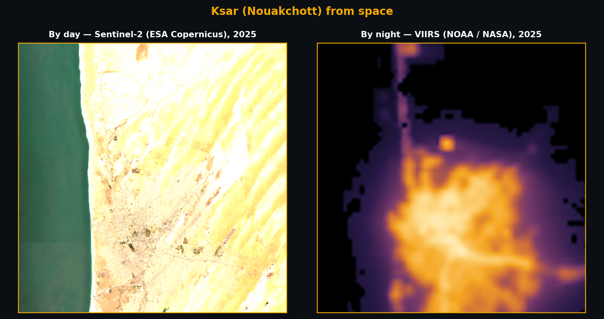
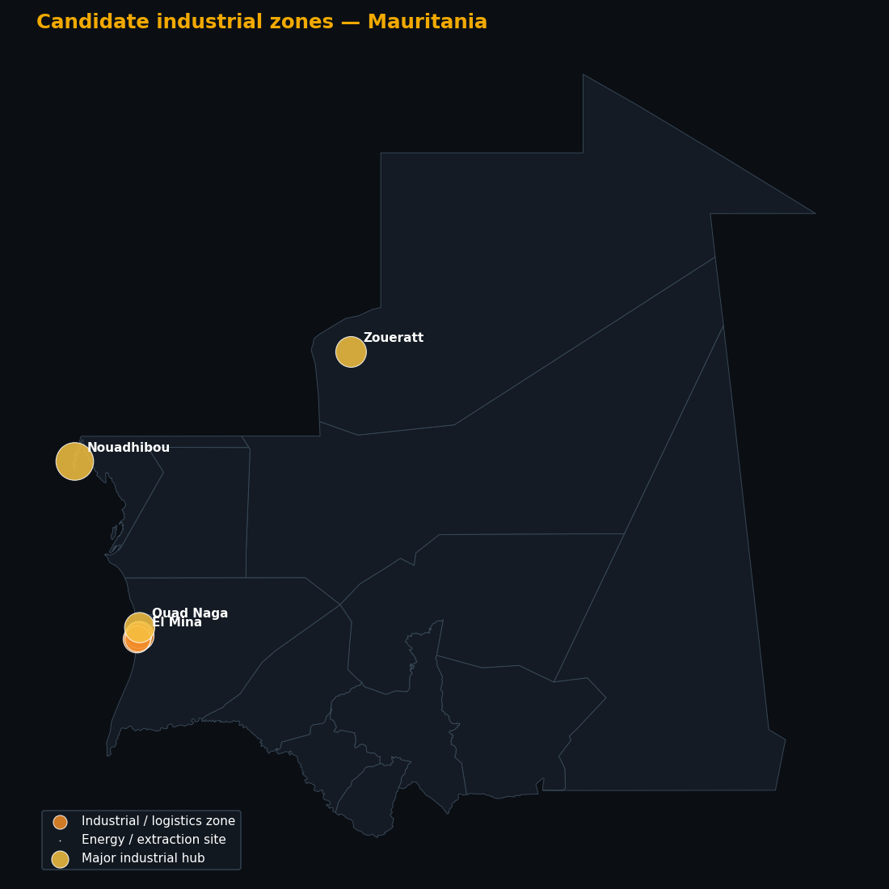
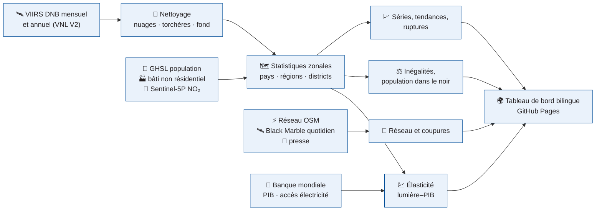

<!-- ntl-dashboard:auto — generated by the night-time lights notebook (part 3); edits will be overwritten -->

<b><a href="https://lamyakejji.github.io/ntl-dashboard/fr/">🌍 Tableau de bord</a> &nbsp;·&nbsp; <a href="https://lamyakejji.github.io/ntl-dashboard/fr/#map">🗺️ Carte</a> &nbsp;·&nbsp; <a href="https://lamyakejji.github.io/ntl-dashboard/fr/#time">📈 Évolution</a> &nbsp;·&nbsp; <a href="https://lamyakejji.github.io/ntl-dashboard/fr/#grid">⚡ Réseau électrique</a> &nbsp;·&nbsp; <a href="https://lamyakejji.github.io/ntl-dashboard/fr/#outages">🔌 Coupures</a> &nbsp;·&nbsp; <a href="https://lamyakejji.github.io/ntl-dashboard/fr/#method">📐 Méthode</a> &nbsp;·&nbsp; <a href="https://lamyakejji.github.io/ntl-dashboard/fr/#data">⬇️ Données</a> &nbsp;·&nbsp; <a href="README.md">🌐 English</a></b>

     

> [!NOTE]
> Ce dépôt héberge le **tableau de bord public** de l'activité économique de **Mauritanie** mesurée par les lumières nocturnes vues par satellite (2014–2025). Le site est bilingue (français / anglais), entièrement statique et régénéré à chaque exécution du notebook.

## 📊 Chiffres clés

<table>
<tr>
<td align="center" width="33%">📈 Croissance annuelle de la lumière <h3>+11,6 %</h3>2014–2025, pente robuste (Theil–Sen)</td>
<td align="center" width="33%">🗓️ 12 derniers mois vs 12 précédents <h3>+6,8 %</h3>série désaisonnalisée, jusqu'à 09/2026</td>
<td align="center" width="33%">💹 Élasticité lumière–PIB <h3>3,30</h3>IC 95 % 2,80 à 3,79 · confiance moyenne</td>
</tr>
<tr>
<td align="center" width="33%">⚖️ Gini de la lumière par habitant <h3>0,69</h3>unités ADM2, 2025</td>
<td align="center" width="33%">🌑 Personnes dans le noir <h3>2,06 M</h3>41 % de la population habitée, 2025</td>
<td align="center" width="33%">🏙️ Part de la 1ʳᵉ région <h3>67 %</h3>Nouakchott, 2025</td>
</tr>
</table>

## 💡 Messages clés

1. **Tendance nationale** — Entre 2014 et 2025, la lumière nocturne de Mauritanie a évolué de +11,6 % par an (IC 95 % : +9,9 % à +12,5 %). Sur les 12 derniers mois, le niveau désaisonnalisé est +6,8 % par rapport aux 12 mois précédents.  
   🟢 élevée · tendance significative (p < 0,01 ; n = 12)
2. **Régions** — Sur 57 unités ADM2, 41 sont en croissance significative, 16 stagnent et 0 déclinent. L'activité lumineuse reste concentrée : Nouakchott concentre 67 % de la lumière nationale.  
   🟠 moyenne · classement sur 57 unités, seuil ±1 %/an et p < 0,10
3. **Convergence** — Entre unités ADM2, la lumière par habitant ne montre ni convergence ni divergence statistiquement établie.  
   🔴 faible · β = −0,009 [−0,023 ; 0,006], n = 52
4. **Lien avec le PIB** — L'élasticité de la lumière au PIB réel est de 3,30 en niveaux (IC 95 % : 2,80 à 3,79, R² = 0,97, 12 années) et de 1,68 en taux de croissance (IC : −0,03 à 3,39). En pseudo temps réel (chaque année prédite à partir des seules années antérieures), la croissance de la lumière suit celle du PIB avec une corrélation de 0,33 (erreur absolue moyenne : 2,5 point(s) de croissance, pas mieux que la meilleure prévision naïve, rapport d'erreur 1,14).  
   🟠 moyenne · relation nette mais seulement 12 années
5. **Inégalités et accès** — Le Gini de la lumière par habitant (ADM2) vaut 0,69 en 2025 (évolution non significative depuis 2014). Environ 2,06 million(s) de personnes vivent dans des zones habitées sans lumière détectable (41 % de la population habitée).  
   🟠 moyenne · sensible au seuil de radiance (de 1,97 à 2,37 M selon le seuil) ; proxy d'éclairage extérieur, pas de raccordement
6. **Zones industrielles** — 7 zones industrielles candidates sont détectées (3 pôles majeurs, 0 sites énergétiques), sur 5 km². Elles émettent 1 % de la lumière nationale ; la première est Nouadhibou (Dakhlet Nouadhibou). Leur lumière évolue de +6,3 % par an.  
   🟠 moyenne · 100 % des zones confirmées par OpenStreetMap ; candidats à vérifier
7. **Réseau électrique** — Le réseau électrique cartographié (OpenStreetMap) totalise 2 813 km de lignes. Entre 2014 et 2025, la lumière des villes à moins de 15 km d'une ligne de transport a varié de +204 %, contre +867 % au-delà de 50 km (descriptif : les lignes OSM ne sont pas datées).  
   low · couverture OSM variable, lignes non datées
8. **Bâti sans lumière** — En 2020, la part du bâti (GHSL) sans lumière détectable est la plus élevée à Barkéol 79%, Maghama 72%, Tintane 68% : l'expansion urbaine y devance le service électrique.  
   medium · le halo lumineux sous-estime cette part dans les grandes villes
9. **Effet des investissements** — Études d'événements (villes traitées vs jamais traitées) — Raccordement haute tension (6 villes) : +0,26 points log, p bootstrap = 0,34; Renforcement de la production (12 villes) : +0,21 points log, p bootstrap = 0,50.  
   low · peu de villes traitées ; dates d'événements de confiance moyenne/faible
10. **Coupures d'électricité** — À Nouakchott, 1,0 % des nuits claires de 2026 (jusqu'au 02/11) montrent une baisse de lumière à l'échelle de la ville compatible avec une coupure (contre 1,0 % en 2014). L'épisode le plus marqué débute le 11/06/2021 : lumière à 9 % de la normale, 96 % des pixels assombris.  
   medium · un passage satellite par nuit (≈ 01 h 30) : coupures de jour invisibles ; 2/4 épisodes documentés observables détectés
11. **Presse et coupures** — 246 articles de presse en ligne (FR, AR, EN) traitent de coupures à Nouakchott. Le pic de couverture est en 08/2026 (42 articles). Thèmes économiques les plus cités : Generation capacity & demand, Investment & finance, Heat & air conditioning, Water supply.  
   low · couverture en ligne inégale dans le temps ; ton estimé par un modèle
12. **Activité par zone** — 2025 : les sites extractifs émettent 8 % de la lumière du pays ; lumière +85 % sur un an dans les mines, +14 % dans le reste du pays.  
   medium · VIIRS mensuel nettoyé ; coordonnées des mines approximatives
13. **NO₂ aux sites** — 2025 : NO₂ en excès sur un anneau de 10 à 30 km (µmol/m²) — zones industrielles (hors extractif) +6.4, zones portuaires +2.4, sites extractifs +1.3. Une moyenne nationale ne peut pas montrer ces sites : ils couvrent moins de 0,1 % du territoire.  
   low · pixels Sentinel-5P d'environ 3,5 × 5,5 km : les petits sites lisent aussi la ville voisine
14. **Ports et commerce** — Commerce maritime 2026T3 (PortWatch) : importations +12 %, exportations +3 % sur un an (tonnages estimés).  
   medium · positions AIS des navires ; tonnage estimé, pas les déclarations douanières
15. **Agriculture (NDVI)** — Saison 2025 (juillet–octobre) : NDVI des zones cultivées +43 % par rapport à la moyenne de long terme ; région la plus en retard : Brakna (+29 %).  
   medium · NDVI METOP sur zones cultivées ; la récolte dépend aussi des crues et de l'irrigation
16. **NDVI et PIB agricole** — Élasticité de la valeur ajoutée agricole au NDVI de saison : 0,18 (1991–2025, p = 0,01).  
   medium · 35 années, erreurs HAC
17. **Marché du travail** — 2026-T2 : chômage 13,2 % (+1,1 pt sur un an) ; jeunes 14-35 ans 23,5 %, femmes 21,7 %. Sous-utilisation au sens large (SU4) : 34,2 %, 47 % chez les jeunes et 50 % chez les femmes.  
   high · enquête trimestrielle ANSADE, ~2 500 ménages par trimestre
18. **Compétences** — Réserve pour la diversification : environ 193 milliers de chômeurs, dont 39 % de niveau secondaire ; le chômage des diplômés du supérieur atteint 17,4 %. Main-d'œuvre disponible, mais peu formée aux métiers techniques.  
   medium · effectifs estimés (population × parts de l'enquête)
19. **Formation et diversification** — Étudiants 2023-2024 : 65 % en sciences sociales, droit, commerce, lettres et arts ; 2,4 % en ingénierie, industrie et construction ; 79 en agriculture — face à des secteurs cibles (mines, gaz, hydrogène, agro-alimentaire, élevage) qui demandent des techniciens.  
   high · annuaire ANSADE 2025 (inscrits, pas diplômés ; formation professionnelle non couverte)
20. **Productivité par secteur** — Le secteur secondaire (mines comprises) produit 32 % de la valeur ajoutée avec 20 % des emplois ; le primaire, 22 % avec 25 %. Déplacer des travailleurs vers les secteurs plus productifs est le moteur de la transformation structurelle.  
   medium · valeur ajoutée Banque mondiale, emplois ENTE : sources et années différentes
21. **Emploi industriel** — Emplois du secondaire : 22,6 % au 2026-T2 (+82 milliers sur un an). Le saut depuis le T3-2025 (de 16 % à 22–25 %) est à confirmer : chantiers (gaz, infrastructures), mines, ou changement de classification.  
   low · quelques trimestres seulement ; parts lues sur les graphiques des rapports
22. **El Niño** — RONI JAS 2026 : +1,7 °C, El Niño fort pendant la saison des pluies. AGRHYMET (mai 2026) place l'ouest du Sahel, dont la Mauritanie, au plus haut risque de déficits et de pauses sèches.  
   high · indice observé (NOAA CPC)
23. **Plans de contingence** — La réponse passe par le Plan national de réponse (DCAN, CSA) fondé sur le Cadre harmonisé, les transferts Elmaouna de Taazour et l'assurance sécheresse ARC. Aucun plan propre à El Niño ni enveloppe internationale d'anticipation (l'appel FAO–PAM ne couvre pas la Mauritanie) n'a été identifié.  
   medium · sources publiques consultées le 4 November 2026
24. **Urbanisation** — Nouakchott regroupe 29,4 % des Mauritaniens en 2023 (21 % en 1988) et croît de 4,2 %/an (2013–2023), contre 3,4 % pour le pays.  
   high · recensements
25. **Villes secondaires** — Les neuf autres villes secondaires accélèrent : 4,1 %/an en 2013–2023 contre 1,7 % en 1988–2000 ; le reste du pays passe de 67 % à 59 % de la population. L'urbanisation descend dans la hiérarchie urbaine.  
   medium · communes : les limites changent d'un recensement à l'autre
26. **Urbain et rural** — Les villes gagnent environ 91 milliers d'habitants par an (3,4 %/an), les zones rurales 35 milliers (1,5 %/an) : chaque année, une ville de la taille de Kiffa s'ajoute aux villes.  
   medium · projections ANSADE sur la base du recensement 2023
27. **Lumières et villes** — Les lumières évoluent à l'inverse de la croissance des villes : corrélation de rang de -0,41 entre la croissance démographique 2013–2023 et la croissance de la lumière de la ville (zone tampon) (2014–2023). La lumière croît le plus vite à Tidjikja, Sélibabi, Aïoun : l'électrification progresse plus vite que la population.  
   low · 12 villes ; zone tampon autour de la ville
28. **Exode rural** — Les personnes en âge de travailler font 63 % de la population urbaine contre 50 % en milieu rural : les jeunes adultes partent en ville, les enfants et les personnes âgées restent.  
   medium · ENTE 2026Q2
29. **Électricité** — 49 % des ménages ont l'électricité en 2023 (20 % en 2004) : plus de 90 % à Nouakchott, Nouadhibou et Zouérate, moins de 25 % dans les deux Hodh, l'Assaba, le Gorgol et le Guidimakha. Chaque nouvel habitant urbain est un raccordement à financer.  
   high · RGPH-5 2023, EPCV
30. **Usage d'internet** — 46 % des Mauritaniens utilisent internet en 2024 (Sénégal 60 %, Maroc 91 %).  
   high · UIT / Banque mondiale
31. **Débit d'internet** — Internet mobile au 2026e trimestre 3 : 124 Mbit/s à Nouakchott contre 47 Mbit/s hors des villes.  
   medium · tests volontaires : plus nombreux là où il y a plus d'utilisateurs
32. **Préparation numérique** — Network Readiness Index 2025 : rang 126 sur 127. Le pilier « personnes » (compétences, usage) est le plus faible (14,5/100).  
   high · Portulans Institute
33. **Coupures d'internet** — 3 coupures d'internet depuis 2019, dont 22 jours d'internet mobile coupé en juillet 2024 après la présidentielle et des coupures pendant le baccalauréat.  
   high · CIVICUS, Internet Society
34. **Réseau routier** — 44 676 km de routes cartographiées, dont 13 % de classes revêtues ; 8,8 km pour 1 000 habitants.  
   medium · OpenStreetMap : bien complet pour les grands axes, incomplet pour les pistes
35. **Inclusion** — 35 unités ADM2 sur 57 sont « critiques » (indice d'inclusion < 20) : 59 % de la population.  
   medium · indice composite : rangs robustes aux poids testés, niveaux non
36. **Routes, services et lumières** — Les unités ADM2 mieux desservies sont aussi plus lumineuses par habitant (Spearman 0,68, 0,66 à densité égale).  
   medium · corrélation de rang, n = 57, p = 0,00 ; pas une relation causale
37. **Robustesse des poids** — Le classement d'inclusion change peu avec les poids : corrélation de rang 0,66 à 0,97 selon le schéma.  
   medium · corrélation de rang avec la pondération de référence
38. **Croissance officielle** — PIB réel 2026T2 : +2,8 % sur un trimestre (CVS), +6,6 % sur un an ; hors gaz +5,9 % sur un an.  
   high · ANSADE, comptes trimestriels
39. **Satellites et comptes nationaux** — Meilleur indicateur avancé : Escales (PortWatch) pour « Transport » (corrélation de rang 0,71, même signe 67 % du temps).  
   medium · 6 trimestres

## 🛰️ Le jour et la nuit

Le principal pôle économique du pays (Ksar (Nouakchott)), le jour vu par Sentinel-2 et la nuit vu par VIIRS. Ce que le satellite voit la nuit — l'éclairage des villes, des ports, des usines et des routes — est l'indicateur indirect d'activité utilisé dans tout ce projet.

## 🌃 Ce qui a changé

Composites annuels VIIRS VNL V2 (torchères masquées), même échelle logarithmique : à gauche 2014, à droite 2025.

## 📈 La tendance

La courbe désaisonnalisée retire les effets de saison (neige, végétation, fêtes) : c'est elle qu'il faut lire pour juger d'une hausse ou d'une baisse.

## 🏭 Zones industrielles

Les sites industriels brillent la nuit comme les villes, mais leurs bâtiments sont surtout non résidentiels, peu de gens y habitent et ils émettent du NO₂. En combinant VIIRS, GHSL (bâti non résidentiel, population) et Sentinel-5P, **7 zones candidates** sont détectées ; elles émettent **1 %** de la lumière nationale. 100 % d'entre elles contiennent une zone industrielle répertoriée dans OpenStreetMap (± 1 km).

| # | Zone | Type | Surface | Part de la lumière nationale | Croissance / an |
|---:|---|---|---:|---:|---:|
| 1 | Nouadhibou (Dakhlet Nouadhibou) | Pôle industriel majeur | 1,8 km² | 0,3 % | +4,3 % |
| 2 | Zoueratt (Tiris Zemmour) | Pôle industriel majeur | 0,8 km² | 0,1 % | +0,1 % |
| 3 | Ouad Naga (Trarza) | Pôle industriel majeur | 0,6 km² | 0,1 % | +1,7 % |
| 4 | El Mina (Nouakchott) | Zone industrielle / logistique | 0,4 km² | 0,1 % | +8,9 % |
| 5 | El Mina (Nouakchott) | Zone industrielle / logistique | 0,4 km² | 0,1 % | +12,3 % |
| 6 | El Mina (Nouakchott) | Zone industrielle / logistique | 0,6 km² | 0,1 % | +6,9 % |
| 7 | El Mina (Nouakchott) | Zone industrielle / logistique | 0,6 km² | 0,1 % | +7,5 % |

## 🧭 Ce que contient le tableau de bord

| Page | Ce que l'on y trouve |
|---|---|
| [**Vue d'ensemble**](https://lamyakejji.github.io/ntl-dashboard/fr/#overview) | chiffres clés, messages générés automatiquement avec leur niveau de confiance |
| [**Carte**](https://lamyakejji.github.io/ntl-dashboard/fr/#map) | lumière année par année, variation, statistiques régionales au survol |
| [**Évolution**](https://lamyakejji.github.io/ntl-dashboard/fr/#time) | série mensuelle observée et désaisonnalisée, glissement annuel, série longue 1992 → |
| [**Régions**](https://lamyakejji.github.io/ntl-dashboard/fr/#regions) | croissance par région et district, classes, concentration et convergence |
| [**Réseau électrique**](https://lamyakejji.github.io/ntl-dashboard/fr/#grid) | lignes OpenStreetMap, événements datés et sourcés, distance au réseau, bâti dans le noir, études d'événements |
| [**Inégalités**](https://lamyakejji.github.io/ntl-dashboard/fr/#inequality) | Gini, courbes de Lorenz, Theil, population « dans le noir » |
| [**Population et urbanisation**](https://lamyakejji.github.io/ntl-dashboard/fr/#urban) | recensements 1988–2023, croissance de Nouakchott et des villes secondaires, urbain / rural, lumières et villes, accès à l'électricité |
| [**Coupures d'électricité**](https://lamyakejji.github.io/ntl-dashboard/fr/#outages) | coupures nuit après nuit (Black Marble quotidien), épisodes, presse : vocabulaire économique |
| [**Croissance**](https://lamyakejji.github.io/ntl-dashboard/fr/#macro) | comptes trimestriels de l'ANSADE, contributions des secteurs, IPI, recoupements satellitaires |
| [**Agriculture**](https://lamyakejji.github.io/ntl-dashboard/fr/#agri) | NDVI des zones cultivées par wilaya, année en cours / précédente / moyenne, élasticités au PIB |
| [**Activité par zone**](https://lamyakejji.github.io/ntl-dashboard/fr/#zones) | lumières (VIIRS ou Black Marble) et NO₂ : mines, zones industrielles, ports, reste du pays |
| [**Zones industrielles**](https://lamyakejji.github.io/ntl-dashboard/fr/#industry) | zones candidates, score, tendance, validation OpenStreetMap |
| [**Ports et commerce**](https://lamyakejji.github.io/ntl-dashboard/fr/#ports) | escales et volumes importés / exportés (FMI PortWatch) |
| [**Marché du travail**](https://lamyakejji.github.io/ntl-dashboard/fr/#labour) | emploi, chômage et sous-utilisation (ENTE), structure de l'emploi, compétences et domaines d'études |
| [**Numérique**](https://lamyakejji.github.io/ntl-dashboard/fr/#digital) | vitesse d'internet (Ookla), usage d'internet, Network Readiness Index, coupures |
| [**Climat**](https://lamyakejji.github.io/ntl-dashboard/fr/#climate) | El Niño, saison des pluies, chaleur, végétation, plans de contingence |
| [**Méthode & limites**](https://lamyakejji.github.io/ntl-dashboard/fr/#method) | sources, paramètres, hypothèses et biais connus |
| [**Données**](https://lamyakejji.github.io/ntl-dashboard/fr/#data) | toutes les tables téléchargeables, manifeste de reproductibilité |

## ⚙️ Comment c'est calculé

Chaîne de traitement exécutée dans Google Earth Engine depuis le notebook *Lumières nocturnes et activité économique* (partie 3) :

<b>Les six analyses en détail</b>

| | |
|---|---|
| **📈 Dynamique temporelle** | décomposition STL, glissement annuel, tendance de Theil–Sen et test de Mann–Kendall, anomalies, ruptures |
| **🗺️ Croissance régionale** | classes Croissance / Stagnation / Déclin (correction de Benjamini–Hochberg), HHI, convergence β et σ |
| **💹 Lumières et PIB** | élasticité (erreurs HAC, bootstrap), prévision immédiate jugée face à deux prévisions naïves, PIB régional expérimental |
| **⚡ Réseau électrique** | lignes OSM, événements datés, distance au réseau, bâti dans le noir, études d'événements (bootstrap sauvage) |
| **⚖️ Inégalités et accès** | Gini, Theil (entre / intra-régions), ratio urbain / rural, population dans le noir sur trois seuils |
| **🔌 Coupures** | Black Marble quotidien : % de la normale, pixels assombris, épisodes ponctuels / prolongés, presse et vocabulaire économique |

## ⚠️ Limites à connaître

> [!IMPORTANT]
> Les lumières mesurent un rayonnement vers 1 h 30, pas une valeur ajoutée. À garder en tête :
>
> - **Débordement et saturation** — la lumière déborde du bâti ; les centres les plus brillants plafonnent
> - **Torchères** — brillantes sans activité locale : masquées, mais à surveiller
> - **Saisonnalité** — nuages, feux et végétation créent des cycles non économiques
> - **Ruptures de capteur** — DMSP → VIIRS, VNL V2.1 → V2.2 : corrigées par indicatrices, pas éliminées
> - **Zones rurales** — le signal est le plus faible là où vivent les ruraux pauvres
> - **Statut** — estimations expérimentales, pas des statistiques officielles

## ⬇️ Télécharger les données

| Fichier | Contenu |
|---|---|
| [`monthly_national.csv`](https://lamyakejji.github.io/ntl-dashboard/fr/data/MRT/monthly_national.csv) | série nationale mensuelle : observée, désaisonnalisée, tendance, anomalies |
| [`annual_units.csv`](https://lamyakejji.github.io/ntl-dashboard/fr/data/MRT/annual_units.csv) | une ligne par unité et par année : lumière, population, lumière/hab., population dans le noir |
| [`regions.csv`](https://lamyakejji.github.io/ntl-dashboard/fr/data/MRT/regions.csv) | indicateurs de la dernière année par région et district (carte, classement) |
| [`gdp.json`](https://lamyakejji.github.io/ntl-dashboard/fr/data/MRT/gdp.json) | élasticité lumière–PIB, prévision immédiate, PIB régional expérimental |
| [`grid.json`](https://lamyakejji.github.io/ntl-dashboard/fr/data/MRT/grid.json) | réseau : événements datés, villes, distance au réseau, études d'événements |
| [`inequality.json`](https://lamyakejji.github.io/ntl-dashboard/fr/data/MRT/inequality.json) | Gini, Lorenz, Theil, population dans le noir et sensibilité aux seuils |
| [`outages.json`](https://lamyakejji.github.io/ntl-dashboard/fr/data/MRT/outages.json) | indice nocturne de coupures, épisodes, taux annuels et mensuels ; news.json : presse |
| [`meta.json`](https://lamyakejji.github.io/ntl-dashboard/fr/data/MRT/meta.json) | paramètres, versions des logiciels, disponibilité des données : la reproductibilité |

📁 [`gh-pages/data/MRT/`](https://github.com/lamyakejji/ntl-dashboard/tree/gh-pages/data/MRT)

## 📚 Données et licences

| Donnée | Producteur | Licence |
|---|---|---|
| VIIRS DNB VNL V2 et mensuel VCMSLCFG | NOAA / Earth Observation Group | domaine public, citation demandée |
| NASA Black Marble VNP46A2 | NASA | domaine public |
| GHSL GHS-POP, GHS-BUILT-S, GHS-SMOD R2023A | Commission européenne, JRC | CC BY 4.0 |
| Sentinel-2 L2A, Sentinel-5P TROPOMI NO₂ | ESA / Copernicus | licence Copernicus (libre) |
| Limites administratives geoBoundaries | William & Mary geoLab | CC BY 4.0 |
| Indicateurs du développement (WDI) | Banque mondiale | CC BY 4.0 |
| Zones industrielles (validation) | OpenStreetMap | ODbL |

## 🗂️ Organisation du dépôt

- `main` — cette page : présentation, illustrations (`docs/img/`), licence, citation
- `gh-pages` — le site publié : `index.html`, `assets/`, `data/<ISO3>/` (toutes les tables téléchargeables), version anglaise dans `en/`

## 🔁 Reproduire ou adapter à un autre pays

Le site est produit par le notebook **Lumières nocturnes et activité économique** (partie 3) (Colab). Changer le code `ISO3` dans la cellule de paramètres suffit pour analyser un autre pays ; les sections 21 et 22 exportent puis republient ce dépôt.

## 🤝 Crédits et citation

Réalisé par la **Banque africaine de développement** dans le cadre de **Data Innovation for Africa (DI4A)**, avec l'**IMF Big Data Center**. *Avertissement : les opinions exprimées sont celles des auteurs et ne reflètent pas nécessairement celles du FMI, de son Conseil d'administration ou de sa direction.* Les estimations sont expérimentales et ne constituent pas des statistiques officielles.

**Licence** — contenus CC BY 4.0, code MIT (voir `LICENSE`). Toute réutilisation doit mentionner : **Source : Banque africaine de développement – Data Innovation for Africa (AfDB-DI4A)**.

**Citation suggérée**

> Banque africaine de développement — Data Innovation for Africa (DI4A) (2026). *Lumières nocturnes et activité économique · 2014–2025 — Mauritanie*. https://lamyakejji.github.io/ntl-dashboard/fr/

---

© 2026 AfDB-DI4A · avec l'IMF Big Data Center · Toute réutilisation doit mentionner « Source : AfDB-DI4A » · Les opinions exprimées ne reflètent pas nécessairement celles du FMI

Dernière mise à jour : 2026-11-07 · <a href="#top">↑</a>

