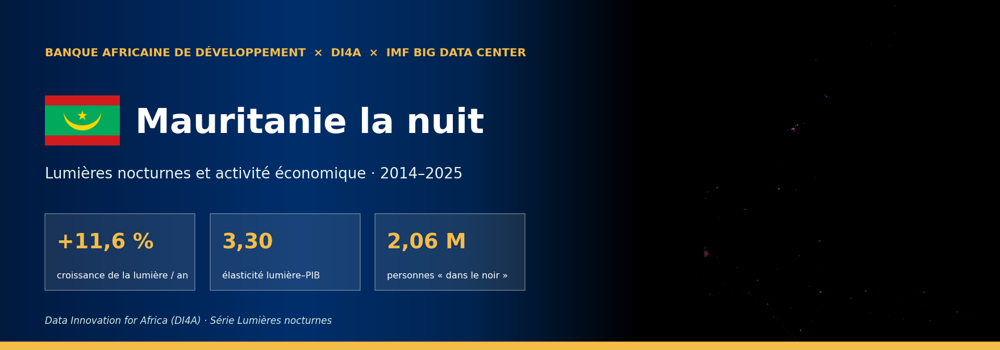
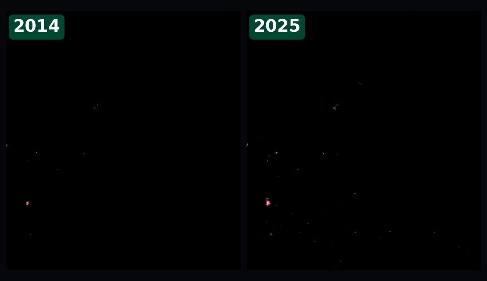
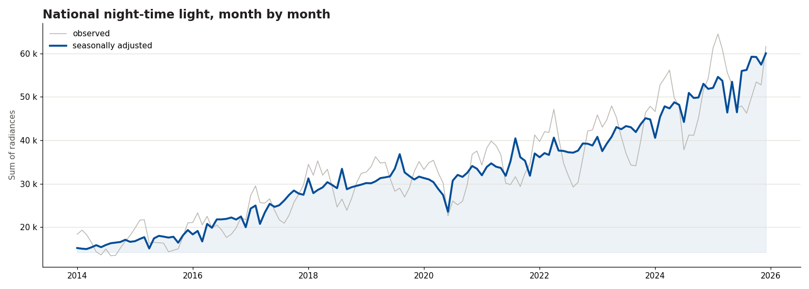
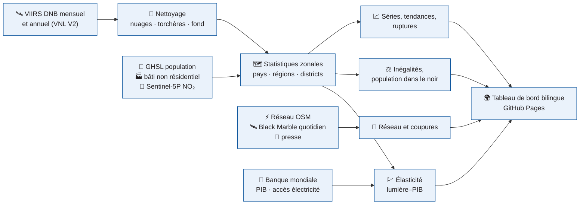

<!-- ntl-dashboard:auto — generated by the night-time lights notebook (part 3); edits will be overwritten -->

<b><a href="https://lamyakejji.github.io/ntl-dashboard/fr/">🌍 Tableau de bord</a> &nbsp;·&nbsp; <a href="https://lamyakejji.github.io/ntl-dashboard/fr/#map">🗺️ Carte</a> &nbsp;·&nbsp; <a href="https://lamyakejji.github.io/ntl-dashboard/fr/#time">📈 Évolution</a> &nbsp;·&nbsp; <a href="https://lamyakejji.github.io/ntl-dashboard/fr/#grid">⚡ Réseau électrique</a> &nbsp;·&nbsp; <a href="https://lamyakejji.github.io/ntl-dashboard/fr/#outages">🔌 Coupures</a> &nbsp;·&nbsp; <a href="https://lamyakejji.github.io/ntl-dashboard/fr/#method">📐 Méthode</a> &nbsp;·&nbsp; <a href="https://lamyakejji.github.io/ntl-dashboard/fr/#data">⬇️ Données</a> &nbsp;·&nbsp; <a href="README.md">🌐 English</a></b>

     

> [!NOTE]
> Ce dépôt héberge le **tableau de bord public** de l'activité économique de **Mauritanie** mesurée par les lumières nocturnes vues par satellite (2014–2025). Le site est bilingue (français / anglais), entièrement statique et régénéré à chaque exécution du notebook.

## 📊 Chiffres clés

<table>
<tr>
<td align="center" width="33%">📈 Croissance annuelle de la lumière <h3>+11,6 %</h3>2014–2025, pente robuste (Theil–Sen)</td>
<td align="center" width="33%">🗓️ 12 derniers mois vs 12 précédents <h3>+13,4 %</h3>série désaisonnalisée, jusqu'à 12/2025</td>
<td align="center" width="33%">💹 Élasticité lumière–PIB <h3>3,30</h3>IC 95 % 2,80 à 3,79 · confiance moyenne</td>
</tr>
<tr>
<td align="center" width="33%">⚖️ Gini de la lumière par habitant <h3>0,69</h3>unités ADM2, 2025</td>
<td align="center" width="33%">🌑 Personnes dans le noir <h3>2,06 M</h3>41 % de la population habitée, 2025</td>
<td align="center" width="33%">🏙️ Part de la 1ʳᵉ région <h3>67 %</h3>Nouakchott, 2025</td>
</tr>
</table>

## 💡 Messages clés

1. **Tendance nationale** — Entre 2014 et 2025, la lumière nocturne de Mauritanie a évolué de +11,6 % par an (IC 95 % : +9,9 % à +12,5 %). Sur les 12 derniers mois, le niveau désaisonnalisé est +13,4 % par rapport aux 12 mois précédents.  
   🟢 élevée · tendance significative (p < 0,01 ; n = 12)
2. **Régions** — Sur 57 unités ADM2, 41 sont en croissance significative, 16 stagnent et 0 déclinent. L'activité lumineuse reste concentrée : Nouakchott concentre 67 % de la lumière nationale.  
   🟠 moyenne · classement sur 57 unités, seuil ±1 %/an et p < 0,10
3. **Convergence** — Entre unités ADM2, la lumière par habitant ne montre ni convergence ni divergence statistiquement établie.  
   🔴 faible · β = −0,009 [−0,023 ; 0,006], n = 52
4. **Lien avec le PIB** — L'élasticité de la lumière au PIB réel est de 3,30 en niveaux (IC 95 % : 2,80 à 3,79, R² = 0,97, 12 années) et de 1,68 en taux de croissance (IC : −0,03 à 3,39). En pseudo temps réel (chaque année prédite à partir des seules années antérieures), la croissance de la lumière suit celle du PIB avec une corrélation de 0,33 (erreur absolue moyenne : 2,5 point(s) de croissance, pas mieux que la meilleure prévision naïve, rapport d'erreur 1,14).  
   🟠 moyenne · relation nette mais seulement 12 années
5. **Inégalités et accès** — Le Gini de la lumière par habitant (ADM2) vaut 0,69 en 2025 (évolution non significative depuis 2014). Environ 2,06 million(s) de personnes vivent dans des zones habitées sans lumière détectable (41 % de la population habitée).  
   🟠 moyenne · sensible au seuil de radiance (de 0,00 à 2,37 M selon le seuil) ; proxy d'éclairage extérieur, pas de raccordement
6. **Réseau électrique** — Le réseau électrique cartographié (OpenStreetMap) totalise 2 813 km de lignes. Entre 2014 et 2025, la lumière des villes à moins de 15 km d'une ligne de transport a varié de +204 %, contre +867 % au-delà de 50 km (descriptif : les lignes OSM ne sont pas datées).  
   low · couverture OSM variable, lignes non datées
7. **Bâti sans lumière** — En 2020, la part du bâti (GHSL) sans lumière détectable est la plus élevée à Barkéol 79%, Maghama 72%, Tintane 68% : l'expansion urbaine y devance le service électrique.  
   medium · le halo lumineux sous-estime cette part dans les grandes villes
8. **Effet des investissements** — Études d'événements (villes traitées vs jamais traitées) — Raccordement haute tension (2 villes) : -0,49 points log, p bootstrap = 0,20; Renforcement de la production (9 villes) : +0,08 points log, p bootstrap = 0,80.  
   low · peu de villes traitées ; dates d'événements de confiance moyenne/faible
9. **Coupures d'électricité** — À Nouakchott, 1,0 % des nuits claires de 2026 (jusqu'au 26/10) montrent une baisse de lumière à l'échelle de la ville compatible avec une coupure (contre 1,0 % en 2014). L'épisode le plus marqué débute le 11/06/2021 : lumière à 9 % de la normale, 96 % des pixels assombris.  
   medium · un passage satellite par nuit (≈ 01 h 30) : coupures de jour invisibles ; 2/4 épisodes documentés observables détectés
10. **Presse et coupures** — 246 articles de presse en ligne (FR, AR, EN) traitent de coupures à Nouakchott ; 63 % ont un ton négatif. Le pic de couverture est en 08/2026 (42 articles). Thèmes économiques les plus cités : Generation capacity & demand, Investment & finance, Heat & air conditioning, Water supply.  
   low · couverture en ligne inégale dans le temps ; ton estimé par un modèle

## 🌃 Ce qui a changé

Composites annuels VIIRS VNL V2 (torchères masquées), même échelle logarithmique : à gauche 2014, à droite 2025.

## 📈 La tendance

La courbe désaisonnalisée retire les effets de saison (neige, végétation, fêtes) : c'est elle qu'il faut lire pour juger d'une hausse ou d'une baisse.

## 🧭 Ce que contient le tableau de bord

| Page | Ce que l'on y trouve |
|---|---|
| [**Vue d'ensemble**](https://lamyakejji.github.io/ntl-dashboard/fr/#overview) | chiffres clés, messages générés automatiquement avec leur niveau de confiance |
| [**Carte**](https://lamyakejji.github.io/ntl-dashboard/fr/#map) | lumière année par année, variation, statistiques régionales au survol |
| [**Évolution**](https://lamyakejji.github.io/ntl-dashboard/fr/#time) | série mensuelle observée et désaisonnalisée, glissement annuel, série longue 1992 → |
| [**Régions**](https://lamyakejji.github.io/ntl-dashboard/fr/#regions) | croissance par région et district, classes, concentration et convergence |
| [**Réseau électrique**](https://lamyakejji.github.io/ntl-dashboard/fr/#grid) | lignes OpenStreetMap, événements datés et sourcés, distance au réseau, bâti dans le noir, études d'événements |
| [**Inégalités**](https://lamyakejji.github.io/ntl-dashboard/fr/#inequality) | Gini, courbes de Lorenz, Theil, population « dans le noir » |
| [**Coupures d'électricité**](https://lamyakejji.github.io/ntl-dashboard/fr/#outages) | coupures nuit après nuit (Black Marble quotidien), épisodes, presse : tonalité et vocabulaire économique |
| [**Méthode & limites**](https://lamyakejji.github.io/ntl-dashboard/fr/#method) | sources, paramètres, hypothèses et biais connus |
| [**Données**](https://lamyakejji.github.io/ntl-dashboard/fr/#data) | toutes les tables téléchargeables, manifeste de reproductibilité |

## ⚙️ Comment c'est calculé

Chaîne de traitement exécutée dans Google Earth Engine depuis le notebook *Lumières nocturnes et activité économique* (partie 3) :

<b>Les six analyses en détail</b>

| | |
|---|---|
| **📈 Dynamique temporelle** | décomposition STL, glissement annuel, tendance de Theil–Sen et test de Mann–Kendall, anomalies, ruptures |
| **🗺️ Croissance régionale** | classes Croissance / Stagnation / Déclin (correction de Benjamini–Hochberg), HHI, convergence β et σ |
| **💹 Lumières et PIB** | élasticité (erreurs HAC, bootstrap), prévision immédiate jugée face à deux prévisions naïves, PIB régional expérimental |
| **⚡ Réseau électrique** | lignes OSM, événements datés, distance au réseau, bâti dans le noir, études d'événements (bootstrap sauvage) |
| **⚖️ Inégalités et accès** | Gini, Theil (entre / intra-régions), ratio urbain / rural, population dans le noir sur trois seuils |
| **🔌 Coupures** | Black Marble quotidien : % de la normale, pixels assombris, épisodes ponctuels / prolongés, presse et vocabulaire économique |

## ⚠️ Limites à connaître

> [!IMPORTANT]
> Les lumières mesurent un rayonnement vers 1 h 30, pas une valeur ajoutée. À garder en tête :
>
> - **Débordement et saturation** — la lumière déborde du bâti ; les centres les plus brillants plafonnent
> - **Torchères** — brillantes sans activité locale : masquées, mais à surveiller
> - **Saisonnalité** — nuages, feux et végétation créent des cycles non économiques
> - **Ruptures de capteur** — DMSP → VIIRS, VNL V2.1 → V2.2 : corrigées par indicatrices, pas éliminées
> - **Zones rurales** — le signal est le plus faible là où vivent les ruraux pauvres
> - **Statut** — estimations expérimentales, pas des statistiques officielles

## ⬇️ Télécharger les données

| Fichier | Contenu |
|---|---|
| [`monthly_national.csv`](https://lamyakejji.github.io/ntl-dashboard/fr/data/MRT/monthly_national.csv) | série nationale mensuelle : observée, désaisonnalisée, tendance, anomalies |
| [`annual_units.csv`](https://lamyakejji.github.io/ntl-dashboard/fr/data/MRT/annual_units.csv) | une ligne par unité et par année : lumière, population, lumière/hab., population dans le noir |
| [`regions.csv`](https://lamyakejji.github.io/ntl-dashboard/fr/data/MRT/regions.csv) | indicateurs de la dernière année par région et district (carte, classement) |
| [`gdp.json`](https://lamyakejji.github.io/ntl-dashboard/fr/data/MRT/gdp.json) | élasticité lumière–PIB, prévision immédiate, PIB régional expérimental |
| [`grid.json`](https://lamyakejji.github.io/ntl-dashboard/fr/data/MRT/grid.json) | réseau : événements datés, villes, distance au réseau, études d'événements |
| [`inequality.json`](https://lamyakejji.github.io/ntl-dashboard/fr/data/MRT/inequality.json) | Gini, Lorenz, Theil, population dans le noir et sensibilité aux seuils |
| [`outages.json`](https://lamyakejji.github.io/ntl-dashboard/fr/data/MRT/outages.json) | indice nocturne de coupures, épisodes, taux annuels et mensuels ; news.json : presse |
| [`meta.json`](https://lamyakejji.github.io/ntl-dashboard/fr/data/MRT/meta.json) | paramètres, versions des logiciels, disponibilité des données : la reproductibilité |

📁 [`gh-pages/data/MRT/`](https://github.com/lamyakejji/ntl-dashboard/tree/gh-pages/data/MRT)

## 📚 Données et licences

| Donnée | Producteur | Licence |
|---|---|---|
| VIIRS DNB VNL V2 et mensuel VCMSLCFG | NOAA / Earth Observation Group | domaine public, citation demandée |
| NASA Black Marble VNP46A2 | NASA | domaine public |
| GHSL GHS-POP, GHS-BUILT-S, GHS-SMOD R2023A | Commission européenne, JRC | CC BY 4.0 |
| Sentinel-2 L2A, Sentinel-5P TROPOMI NO₂ | ESA / Copernicus | licence Copernicus (libre) |
| Limites administratives geoBoundaries | William & Mary geoLab | CC BY 4.0 |
| Indicateurs du développement (WDI) | Banque mondiale | CC BY 4.0 |
| Zones industrielles (validation) | OpenStreetMap | ODbL |

## 🗂️ Organisation du dépôt

- `main` — cette page : présentation, illustrations (`docs/img/`), licence, citation
- `gh-pages` — le site publié : `index.html`, `assets/`, `data/<ISO3>/` (toutes les tables téléchargeables), version anglaise dans `en/`

## 🔁 Reproduire ou adapter à un autre pays

Le site est produit par le notebook **Lumières nocturnes et activité économique** (partie 3) (Colab). Changer le code `ISO3` dans la cellule de paramètres suffit pour analyser un autre pays ; les sections 12 et 13 exportent puis republient ce dépôt.

## 🤝 Crédits et citation

Réalisé par la **Banque africaine de développement** dans le cadre de **Data Innovation for Africa (DI4A)**, avec l'**IMF Big Data Center**. *Avertissement : les opinions exprimées sont celles des auteurs et ne reflètent pas nécessairement celles du FMI, de son Conseil d'administration ou de sa direction.* Les estimations sont expérimentales et ne constituent pas des statistiques officielles.

**Licence** — contenus CC BY 4.0, code MIT (voir `LICENSE`). Toute réutilisation doit mentionner : **Source : Banque africaine de développement – Data Innovation for Africa (AfDB-DI4A)**.

**Citation suggérée**

> Banque africaine de développement — Data Innovation for Africa (DI4A) (2026). *Lumières nocturnes et activité économique · 2014–2025 — Mauritanie*. https://lamyakejji.github.io/ntl-dashboard/fr/

---

© 2026 AfDB-DI4A · avec l'IMF Big Data Center · Toute réutilisation doit mentionner « Source : AfDB-DI4A » · Les opinions exprimées ne reflètent pas nécessairement celles du FMI

Dernière mise à jour : 2026-11-02 · <a href="#top">↑</a>

