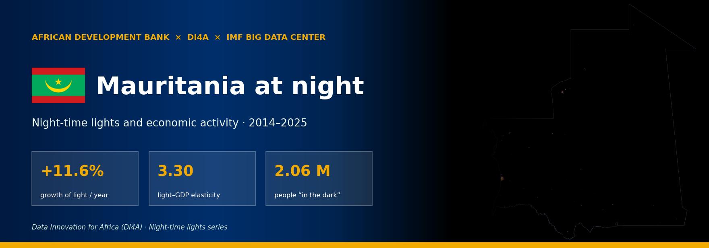
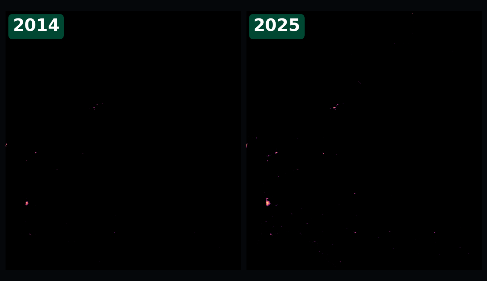
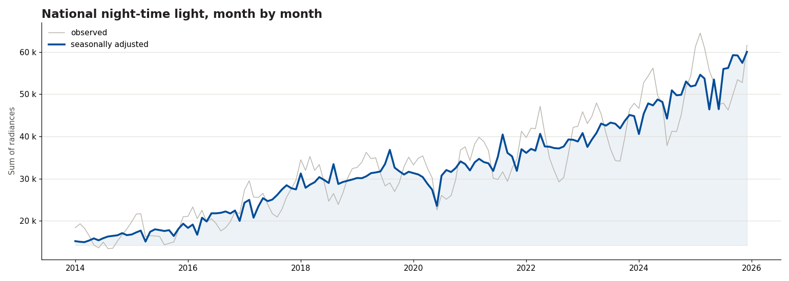
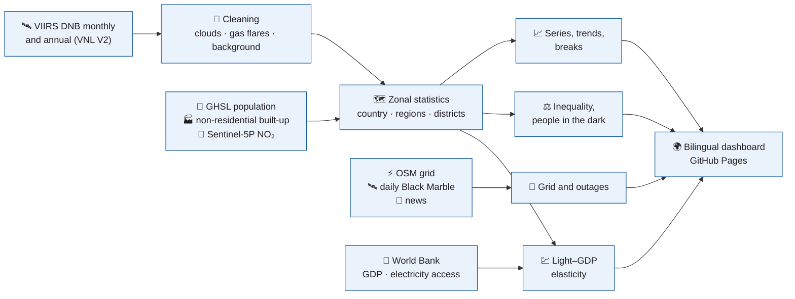

<!-- ntl-dashboard:auto — generated by the night-time lights notebook (part 3); edits will be overwritten -->

<b><a href="https://lamyakejji.github.io/ntl-dashboard/">🌍 Dashboard</a> &nbsp;·&nbsp; <a href="https://lamyakejji.github.io/ntl-dashboard/#map">🗺️ Map</a> &nbsp;·&nbsp; <a href="https://lamyakejji.github.io/ntl-dashboard/#time">📈 Trends</a> &nbsp;·&nbsp; <a href="https://lamyakejji.github.io/ntl-dashboard/#grid">⚡ Electricity grid</a> &nbsp;·&nbsp; <a href="https://lamyakejji.github.io/ntl-dashboard/#outages">🔌 Power outages</a> &nbsp;·&nbsp; <a href="https://lamyakejji.github.io/ntl-dashboard/#method">📐 Method</a> &nbsp;·&nbsp; <a href="https://lamyakejji.github.io/ntl-dashboard/#data">⬇️ Data</a> &nbsp;·&nbsp; <a href="README.fr.md">🌐 Français</a></b>

     

> [!NOTE]
> This repository hosts the **public dashboard** of economic activity in **Mauritania** measured with night-time lights seen from space (2014–2025). The site is bilingual (English / French), fully static and regenerated each time the notebook runs.

## 📊 Key figures

<table>
<tr>
<td align="center" width="33%">📈 Annual growth of light <h3>+11.6%</h3>2014–2025, robust slope (Theil–Sen)</td>
<td align="center" width="33%">🗓️ Last 12 months vs previous 12 <h3>+13.4%</h3>seasonally adjusted series, up to 12/2025</td>
<td align="center" width="33%">💹 Light–GDP elasticity <h3>3.30</h3>95% CI 2.80 to 3.79 · confidence medium</td>
</tr>
<tr>
<td align="center" width="33%">⚖️ Gini of light per capita <h3>0.69</h3>ADM2 units, 2025</td>
<td align="center" width="33%">🌑 People in the dark <h3>2.06 M</h3>41% of the inhabited population, 2025</td>
<td align="center" width="33%">🏙️ Share of the top region <h3>67%</h3>Nouakchott, 2025</td>
</tr>
</table>

## 💡 Key messages

1. **National trend** — Between 2014 and 2025, night-time light in Mauritania changed by +11.6% per year (95% CI: +9.9% to +12.5%). Over the last 12 months, the seasonally adjusted level is +13.4% relative to the previous 12 months.  
   🟢 high · significant trend (p < 0.01; n = 12)
2. **Regions** — Of 57 ADM2 units, 41 show significant growth, 16 are stagnating and 0 are declining. Light remains concentrated: Nouakchott accounts for 67% of national light.  
   🟠 medium · classification of 57 units, threshold ±1%/yr and p < 0.10
3. **Convergence** — Across ADM2 units, light per capita shows neither statistically established convergence nor divergence.  
   🔴 low · β = −0.009 [−0.023; 0.006], n = 52
4. **Link with GDP** — The elasticity of light with respect to real GDP is 3.30 in levels (95% CI: 2.80 to 3.79, R² = 0.97, 12 years) and 1.68 in growth rates (CI: −0.03 to 3.39). In pseudo-real time (each year predicted from earlier years only), light growth tracks GDP growth with a correlation of 0.33 (mean absolute error: 2.5 percentage points of growth, no better than the best naive forecast, error ratio 1.14).  
   🟠 medium · clear relationship but only 12 years
5. **Inequality and access** — The Gini coefficient of light per capita (ADM2) is 0.69 in 2025 (no significant change since 2014). About 2.06 million people live in inhabited areas with no detectable light (41% of the inhabited population).  
   🟠 medium · sensitive to the radiance threshold (from 0.00 to 2.37 M depending on the threshold); a proxy for outdoor lighting, not for grid connection
6. **Electricity grid** — The mapped grid (OpenStreetMap) totals 2,813 km of line. Between 2014 and 2025, light in towns within 15 km of a transmission line changed by +204%, against +867% beyond 50 km (descriptive: OSM lines carry no dates).  
   🔴 low · OSM coverage varies, lines are undated
7. **Built-up land left dark** — In 2020, the share of built-up land (GHSL) with no detectable light is highest in Barkéol 79%, Maghama 72%, Tintane 68%: urban expansion runs ahead of electricity service there.  
   🟠 medium · blooming understates this share in large cities
8. **Effect of grid investments** — Event studies (treated vs never-treated towns) — HV connection (2 towns): -0.49 log points, wild-bootstrap p = 0.20; Generation upgrade (9 towns): +0.08 log points, wild-bootstrap p = 0.80.  
   🔴 low · few treated towns; event dates of medium/low confidence
9. **Power outages** — In Nouakchott, 1.0% of clear nights in 2026 (to 26 Oct) show a citywide drop in light consistent with a power outage (against 1.0% in 2014). The deepest episode starts on 11 Jun 2021: light at 9% of normal, 96% of pixels dimmed.  
   🟠 medium · one satellite pass per night (≈01:30): daytime cuts are invisible; 2/4 observable documented episodes detected
10. **News on outages** — 246 online news articles (FR, AR, EN) cover power cuts in Nouakchott. Coverage peaks in Aug 2026 (42 articles). Most-cited economic themes: Generation capacity & demand, Investment & finance, Heat & air conditioning, Water supply.  
   🔴 low · uneven online coverage over time; tone estimated by a model
11. **Agriculture (NDVI)** — 2025 growing season (July–October): cropland NDVI +43% vs its long-term average; weakest region: Brakna (+29%).  
   🟠 medium · METOP NDVI over cropland; harvests also depend on floods and irrigation
12. **NDVI and agricultural GDP** — Elasticity of agricultural value added to growing-season NDVI: 0.18 (1991–2025, p = 0.01).  
   🟠 medium · 35 years, HAC errors
13. **Official growth** — Real GDP 2026Q2: +2.8% q/q (SA), +6.6% y/y; excluding gas +5.9% y/y.  
   🟢 high · ANSADE quarterly accounts
14. **Satellites vs national accounts** — Best satellite proxy: NDVI over cropland (national) for “Agriculture” (rank correlation 0.45, same sign 57% of the time).  
   🔴 low · 14 quarters

## 🌃 What changed

VIIRS VNL V2 annual composites (gas flares masked), same logarithmic scale: left 2014, right 2025.

## 📈 The trend

The seasonally adjusted curve removes seasonal effects (snow, vegetation, festivities): read it to judge a rise or a fall.

## 🧭 What the dashboard contains

| Page | What you will find |
|---|---|
| [**Overview**](https://lamyakejji.github.io/ntl-dashboard/#overview) | key figures, automatically generated messages with their confidence level |
| [**Map**](https://lamyakejji.github.io/ntl-dashboard/#map) | light year by year, change, regional statistics on hover |
| [**Trends**](https://lamyakejji.github.io/ntl-dashboard/#time) | observed and seasonally adjusted monthly series, year-on-year change, long series 1992 → |
| [**Regions**](https://lamyakejji.github.io/ntl-dashboard/#regions) | growth by region and district, classes, concentration and convergence |
| [**Electricity grid**](https://lamyakejji.github.io/ntl-dashboard/#grid) | OpenStreetMap lines, dated and sourced events, distance to the grid, built-up land left dark, event studies |
| [**Inequality**](https://lamyakejji.github.io/ntl-dashboard/#inequality) | Gini, Lorenz curves, Theil, people “in the dark” |
| [**Power outages**](https://lamyakejji.github.io/ntl-dashboard/#outages) | night-by-night outages (daily Black Marble), episodes, news: economic vocabulary |
| [**Growth**](https://lamyakejji.github.io/ntl-dashboard/#macro) | ANSADE quarterly accounts, sector contributions, IPI, satellite cross-checks |
| [**Agriculture**](https://lamyakejji.github.io/ntl-dashboard/#agri) | NDVI over cropland by wilaya, current / previous year / long-term average, GDP elasticities |
| [**Activity by zone**](https://lamyakejji.github.io/ntl-dashboard/#zones) | lights (VIIRS or Black Marble) and NO₂: mines, industrial zones, ports, rest of the country |
| [**Industrial zones**](https://lamyakejji.github.io/ntl-dashboard/#industry) | candidate zones, score, trend, OpenStreetMap validation |
| [**Ports & trade**](https://lamyakejji.github.io/ntl-dashboard/#ports) | port calls and import / export volumes (IMF PortWatch) |
| [**Method & limitations**](https://lamyakejji.github.io/ntl-dashboard/#method) | sources, parameters, assumptions and known biases |
| [**Data**](https://lamyakejji.github.io/ntl-dashboard/#data) | every downloadable table, reproducibility manifest |

## ⚙️ How it is computed

Processing chain run on Google Earth Engine from the *Night-time lights and economic activity* notebook (part 3):

<b>The six analyses in detail</b>

| | |
|---|---|
| **📈 Time dynamics** | STL decomposition, year-on-year change, Theil–Sen trend with Mann–Kendall test, anomalies, breaks |
| **🗺️ Regional growth** | Growth / Stagnation / Decline classes (Benjamini–Hochberg correction), HHI, β and σ convergence |
| **💹 Lights and GDP** | elasticity (HAC errors, bootstrap), nowcast judged against two naive forecasts, experimental regional GDP |
| **⚡ Electricity grid** | OSM lines, dated events, distance to the grid, built-up land left dark, event studies (wild bootstrap) |
| **⚖️ Inequality and access** | Gini, Theil (between / within regions), urban / rural ratio, people in the dark at three thresholds |
| **🔌 Power outages** | daily Black Marble: % of normal, dimmed pixels, sporadic / prolonged episodes, news tone and economic vocabulary |

## ⚠️ Limitations to keep in mind

> [!IMPORTANT]
> Lights measure radiance at about 1:30 a.m., not value added. Keep in mind:
>
> - **Blooming and saturation** — light spills beyond built-up areas; the brightest cores plateau
> - **Gas flares** — bright without local activity: masked, but worth watching
> - **Seasonality** — clouds, fires and vegetation create non-economic cycles
> - **Sensor breaks** — DMSP → VIIRS, VNL V2.1 → V2.2: handled with dummies, not eliminated
> - **Rural areas** — the signal is weakest where the rural poor live
> - **Status** — experimental estimates, not official statistics

## ⬇️ Download the data

| File | Content |
|---|---|
| [`monthly_national.csv`](https://lamyakejji.github.io/ntl-dashboard/data/MRT/monthly_national.csv) | national monthly series: observed, seasonally adjusted, trend, anomalies |
| [`annual_units.csv`](https://lamyakejji.github.io/ntl-dashboard/data/MRT/annual_units.csv) | one row per unit and year: light, population, light per capita, people in the dark |
| [`regions.csv`](https://lamyakejji.github.io/ntl-dashboard/data/MRT/regions.csv) | latest-year indicators by region and district (map, ranking) |
| [`gdp.json`](https://lamyakejji.github.io/ntl-dashboard/data/MRT/gdp.json) | light–GDP elasticity, nowcast, experimental regional GDP |
| [`grid.json`](https://lamyakejji.github.io/ntl-dashboard/data/MRT/grid.json) | grid: dated events, towns, distance to the grid, event studies |
| [`inequality.json`](https://lamyakejji.github.io/ntl-dashboard/data/MRT/inequality.json) | Gini, Lorenz, Theil, people in the dark and threshold sensitivity |
| [`outages.json`](https://lamyakejji.github.io/ntl-dashboard/data/MRT/outages.json) | nightly outage index, episodes, yearly and monthly rates; news.json: news coverage |
| [`meta.json`](https://lamyakejji.github.io/ntl-dashboard/data/MRT/meta.json) | parameters, software versions, dataset availability: reproducibility |

📁 [`gh-pages/data/MRT/`](https://github.com/lamyakejji/ntl-dashboard/tree/gh-pages/data/MRT)

## 📚 Data and licences

| Dataset | Producer | Licence |
|---|---|---|
| VIIRS DNB VNL V2 and monthly VCMSLCFG | NOAA / Earth Observation Group | public domain, citation requested |
| NASA Black Marble VNP46A2 | NASA | public domain |
| GHSL GHS-POP, GHS-BUILT-S, GHS-SMOD R2023A | European Commission, JRC | CC BY 4.0 |
| Sentinel-2 L2A, Sentinel-5P TROPOMI NO₂ | ESA / Copernicus | Copernicus licence (free) |
| geoBoundaries administrative boundaries | William & Mary geoLab | CC BY 4.0 |
| World Development Indicators | World Bank | CC BY 4.0 |
| Industrial areas (validation) | OpenStreetMap | ODbL |

## 🗂️ Repository layout

- `main` — this page: presentation, illustrations (`docs/img/`), licence, citation
- `gh-pages` — the published site: `index.html`, `assets/`, `data/<ISO3>/` (every table downloadable), French version in `fr/`

## 🔁 Reproduce or adapt to another country

The site is produced by the **Night-time lights and economic activity** notebook (part 3) (Colab). Changing the `ISO3` code in the parameters cell is enough to analyse another country; sections 12 and 13 export and re-publish this repository.

## 🤝 Credits and citation

Produced by the **African Development Bank** as part of **Data Innovation for Africa (DI4A)**, with the **IMF Big Data Center**. *Disclaimer: the views expressed are those of the authors and do not necessarily represent the views of the IMF, its Executive Board, or IMF management.* Estimates are experimental and are not official statistics.

**Licence** — content CC BY 4.0, code MIT (see `LICENSE`). Any reuse must cite: **Source: African Development Bank – Data Innovation for Africa (AfDB-DI4A)**.

**Suggested citation**

> African Development Bank — Data Innovation for Africa (DI4A) (2026). *Night-time lights and economic activity · 2014–2025 — Mauritania*. https://lamyakejji.github.io/ntl-dashboard/

---

© 2026 AfDB-DI4A · with the IMF Big Data Center · Any reuse must cite “Source: AfDB-DI4A” · The views expressed do not necessarily represent the views of the IMF

Last update: 2026-11-03 · <a href="#top">↑</a>

